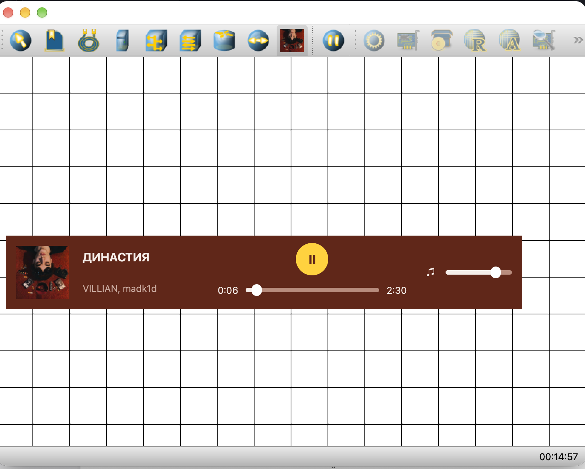
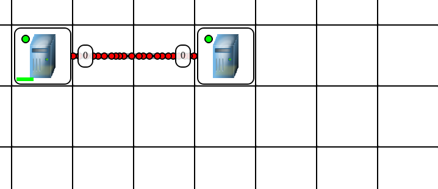
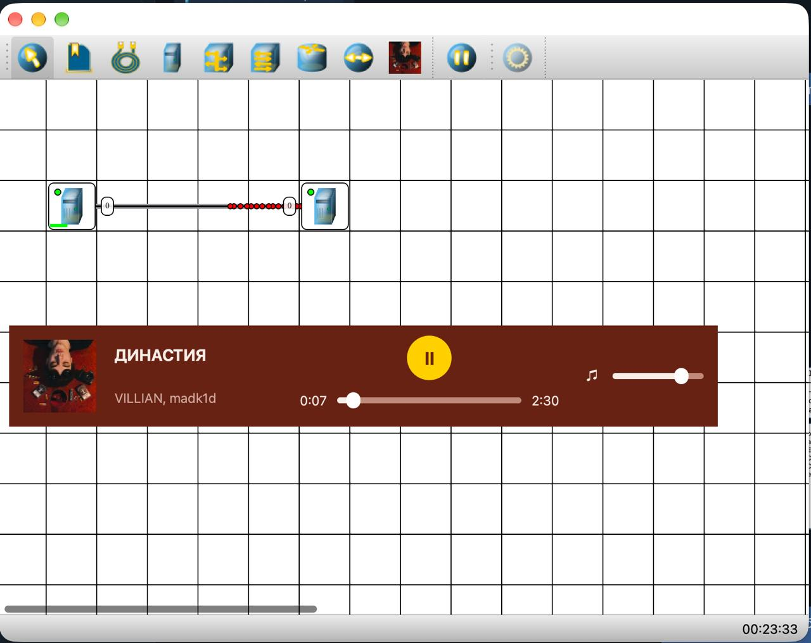

# NetEmul

**NetEmul** — приложение для моделирования компьютерных сетей. На рабочем поле можно размещать сетевые устройства, соединять их и наблюдать за передачей данных.

> Этот репозиторий содержит версию NetEmul с музыкальным плеером **«Династия»**.

## Возможности

- Построение схем компьютерных сетей на графическом холсте.
- Добавление компьютеров, концентраторов, коммутаторов и маршрутизаторов.
- Соединение устройств и настройка параметров сети.
- Сохранение и открытие проектов.
- Отмена и повтор изменений.
- Встроенный плеер «Династия»: воспроизведение и пауза, перемотка и регулировка громкости.
- Перемещение плеера правой кнопкой мыши и удаление из контекстного меню.

## Скриншоты и обложка

Плеер «Династия» в NetEmul:



Передача пакетов между сетевыми устройствами:



Схема сети с работающим плеером:



Обложка встроенного плеера:


## Сборки

Готовые сборки для macOS и Windows будут публиковаться на странице [Releases](../../releases):

- macOS — образ `.dmg`;
- Windows — установщик `.exe`.

Версия проекта указывается в [`version.txt`](version.txt). GitHub Actions настроен собирать пакеты и создавать GitHub Release для новой версии, если для соответствующего тега `v<версия>` релиза ещё нет.

## Сборка из исходников

Проект использует **Qt 5.15** и **qmake**. Для сборки нужны компилятор C++ и модули Qt, указанные в проекте.

Пример для macOS/Linux:

```sh
cd netemul-1.0
qmake netemul.pro
make -j4
```

Для Windows следует использовать Qt 5.15 с MinGW 8.1 (64-bit), затем открыть `netemul.pro` через `qmake` и собрать проект командой `mingw32-make`.

## Запуск автоматической публикации

1. Опубликуйте репозиторий на GitHub и убедитесь, что ветка по умолчанию называется `main`.
2. В `version.txt` укажите новую версию в формате `0.9.7` — без префикса `v`.
3. Закоммитьте и отправьте изменения в `main`.
4. GitHub Actions проверит наличие тега `v0.9.7`. Если тег уже существует, сборка пропускается. Если версии ещё нет, workflow соберёт `.dmg` и Windows `.exe`, создаст тег и оформит Release с обоими файлами.

Для загрузки файлов workflow требуются права `contents: write`, заданные в файле GitHub Actions.

## Лицензия

NetEmul распространяется на условиях **GNU LGPL версии 2.1 или более поздней**. Подробности — в файле [`netemul-1.0/copyright`](netemul-1.0/copyright).
